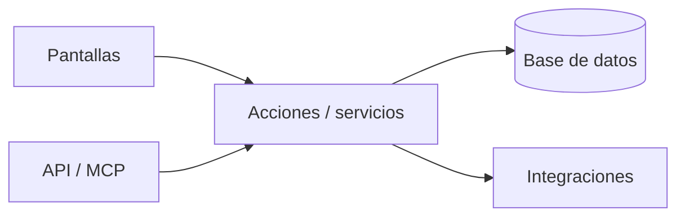

# Arquitectura de <proyecto>

Estado: Propuesta | Aceptada · Última revisión: <fecha> · Responsable: <persona>

## Contexto

<Qué es, para quién, usuarios hoy y en 12 meses, criticidad.>

## Decisiones principales

| Área | Decisión | ADR |
| --- | --- | --- |
| Estilo | Monolito modular con vertical slices | [0001](adr/0001-...) |
| Lenguaje / framework | | |
| Base de datos | | |
| Autenticación y permisos | | |
| Hosting y despliegue | | |
| Escalado | Vertical, sin estado en memoria | |
| Colas / jobs | | |
| Frontend y design system | | |

## Componentes



## Estructura de carpetas

```text
src/
├── esqueleto/          # auth, acceso a datos, errores, logging (lo define una persona)
├── features/<feature>/ # una carpeta por feature: ui, modelo, acciones, tests
└── ui/                 # design tokens y componentes compartidos
```

Ejemplo canónico de cada patrón: <ruta del archivo a imitar>.

## Flujo de datos y reglas

- Toda escritura pasa por <capa>.
- La lógica de pantalla vive en <dónde>.
- Multi-cliente: <cómo se filtra por cliente en cada consulta>.

## Escalado

<Decisión, disparadores para revisarla (usuarios, latencia, costo) y qué ya está preparado.>

## Seguridad y datos

<Datos sensibles, quién accede a qué, secretos, auditoría, backups.>

## Observabilidad

<Logs estructurados, errores, métricas, alertas.>

## Estrategia de tests

| Nivel | Herramienta | Qué cubre | Dónde corre |
| --- | --- | --- | --- |
| Unit | | Lógica pura | Pre-commit y CI |
| Integración | | Acciones contra base real | CI |
| E2E | Playwright | Journeys críticos | CI y compuerta |

## Preguntas abiertas

- <…>
